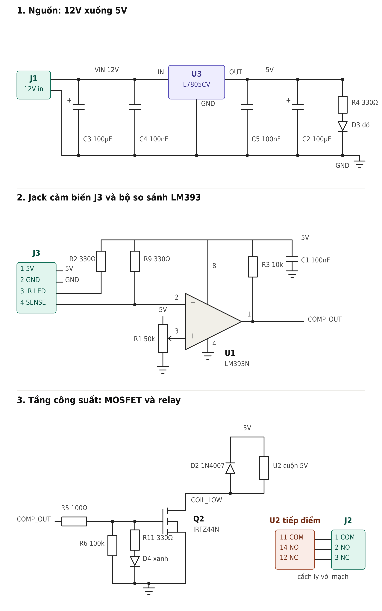

This is a project from intro to engineering (Haui university)

Components list:
- 7805 * 1
- 100uF capacitor * 2
- 104 ceramic capacitor * 2
- 100 ohm resistor * 1
- 330 ohm reistor * 4 
- 10k resistor * 2 
- 100k resistor * 1k
- Ir receiver * 1
- Ir transmitter * 1
- Ic lm393 * 1
- 50k potentiometer * 1 
- Irfz44 * 1 (i choose irfz44 because i avaible in my room)
- Relay 5vdc * 1
- flyback diode * 1
- 12v pump 
- 12v adapter 

How is works?
- IR Emission & Reflection: The IR transmitter continuously emits an infrared beam. Placing a cup in front of the sensor reflects this beam back toward the IR receiver.
- Signal Detection: As the IR receiver absorbs the reflected light, its internal resistance drops (photoconductive effect), pulling down the voltage at the sensor node.
- Threshold Comparison (LM393): The LM393 comparator compares this changing sensor voltage with a fixed reference voltage ($V_{ref}$) adjusted via an onboard potentiometer.
- Pump Activation & Calibration: When the sensor voltage falls below $V_{ref}$, the LM393 switches its output state to activate the water pump. Turning the potentiometer changes $V_{ref}$, allowing precise calibration of the sensing range.

Schematic:

Prototype on breadboard:

short demo: [youtube link](https://youtu.be/mfwWYmZwk9E)
